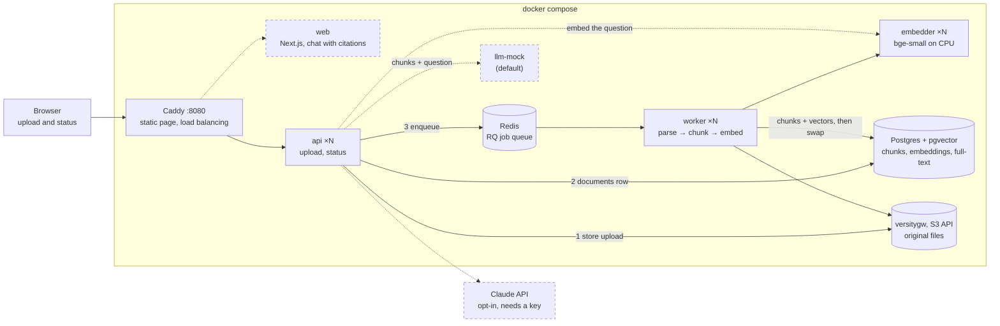

# Docs Q&A with citations

Ask questions about your docs and get streamed answers that cite the exact source passage, measured by an eval suite.

The step-by-step build plan is in [PLAN.md](PLAN.md).

> **Status:** phase 1 of 6. Upload a PDF, HTML or Markdown file and watch it get parsed, chunked,
> embedded and indexed. Search and answers are next. There is no auth until phase 4: everyone
> shares one workspace, so don't expose it to the internet yet.

## Run it

```bash
git clone --recurse-submodules https://github.com/gonzalo-gigena/docs-qa.git
cd docs-qa
cp .env.example .env
docker compose up --watch
```

Open http://localhost:8080 and upload a document. Needs only Docker Engine 25+ with Compose v2,
and 8 GB of RAM for Docker. The embedding model is baked in at build time, so running it needs
no network and no keys. Code changes reload
automatically (Compose Watch). On Windows, clone inside the WSL filesystem, not `/mnt/c`.

Cloned without `--recurse-submodules`? Run `git submodule update --init`.

## Everyday commands

| What | Command |
|---|---|
| Seed demo data | `docker compose run --rm seed` |
| SQL shell | `docker compose exec db psql -U app app` |
| Scale the api | `docker compose up -d --scale api=3` |
| Prove scaling works | `sh common/scripts/smoke.sh 3` |
| Run exactly what CI runs | `sh common/scripts/ci-stack.sh 3` |
| Load test at 1, 2, 4 replicas | `sh common/scripts/scale.sh` |
| Metrics (Prometheus) | `docker compose --profile observability up -d`, then http://localhost:9090 |
| Unit tests | `docker compose run --rm --no-deps --build -v "$PWD/apps/api/tests:/app/tests:ro" api python -m unittest discover -v tests` |
| Ingestion test, stack running | `docker compose run --rm --no-deps -v "$PWD/apps/api/tests:/app/tests:ro" api python -m tests.e2e_ingest` |
| Time a 300-page ingest | `docker compose run --rm --no-deps -v "$PWD/apps/api/tests:/app/tests:ro" api python -m tests.bench_ingest` |
| Scale ingestion | `docker compose up -d --scale worker=2 --scale embedder=2` |
| Upload from a shell | `curl -F file=@handbook.pdf localhost:8080/api/documents` |
| New migration | add `infra/db/migrations/00000N_name.up.sql` + `.down.sql`, restart |
| Update shared code | `git submodule update --remote common` |
| Reset everything | `docker compose down -v` |

## Architecture



Solid boxes and arrows run today. Dashed ones are planned in [PLAN.md](PLAN.md).

### How ingestion works

1. `POST /api/documents` hashes the file. A document is its file name within a workspace. Same name
   and same hash is a no-op (`200`, `"unchanged": true`). Otherwise the file is stored, a new
   `queued` version is inserted and a job is enqueued (`202`).
2. The worker extracts text and structure: pages and bookmarks from PDFs (no bookmarks means no
   heading paths), headings from HTML and Markdown. Scanned PDFs fail with a reason, there is no OCR.
3. It chunks inside each section, up to 400 tokens with 15% overlap, cutting at paragraph, then
   sentence, then word boundaries.
4. It embeds 64 chunks at a time and reports progress: `queued → parsing → embedding → ready`,
   or `failed` with the reason.
5. One transaction marks the new version `ready` and deletes the older ones. Until then the old
   version stays ready. **Anything that reads chunks must filter on `documents.status = 'ready'`.**

When something breaks:

| Failure | What happens |
|---|---|
| Bad file, or the embedder is down for over a minute | `failed` with the reason. Upload the same file again to retry. |
| A worker process dies mid-job | Retried twice, then `failed`. A lost container is noticed after about 2–3 minutes. |
| Deploy (SIGTERM) | The worker finishes its document, for up to 120 s. A longer one is killed and retried. |
| Redis is down during upload | `503`. The file is saved, and uploading it again enqueues it. |
| Redis loses its data | A starting worker re-enqueues every unfinished document. |

Ingestion and answering are separate paths. Uploads go through a queue to workers, so heavy ingestion never slows chat down. Answers use only retrieved chunks, and each citation points to the exact passage.

## Stack

- **api:** Python 3.15 (FastAPI + psycopg + Prometheus client). Stateless, so it scales with `--scale api=N`.
- **worker:** the api image run as `python -m app.worker` (RQ, pypdf, trafilatura).
- **embedder:** FastAPI + fastembed on Python 3.14, because onnxruntime has no 3.15 wheels yet.
- **storage:** versitygw, S3 API over a Docker volume.
- **Caddy:** the only service with a host port. It load-balances `/api/*` across every
  replica (`import lb api 8080`, from common) and serves `apps/web`.
- **Postgres 17 with pgvector:** migrations run once before the api starts (`golang-migrate`).
- **common/:** git submodule with the shared fakes, scripts, Caddy snippet and Prometheus.
  See [portfolio-common](common/README.md).

## Deploy (one VM)

```bash
docker compose -f compose.yaml -f compose.prod.yaml up -d
```

The server's `.env` needs `SITE_ADDRESS`, `IMAGE_REPO`, `TAG`, strong `POSTGRES_PASSWORD` and `S3_SECRET_KEY`, and no `fakes`
profile. Caddy gets TLS automatically. CI pushes multi-arch images to GHCR on every merge to `main`.

## Decisions & tradeoffs

| Decision | Chosen | Rejected | Why, and what it costs |
|---|---|---|---|
| Vector store | pgvector in the same Postgres (HNSW, cosine) | Pinecone, Qdrant, Weaviate | Vectors, text, the full-text index and permissions live in one database and one transaction. That holds up to roughly 10M chunks. Cost: HNSW filters after the index scan, so a small workspace can get fewer than k results. pgvector 0.8 iterative scans fix that. |
| Retrieval | Hybrid: vector top-k plus Postgres full-text, merged with Reciprocal Rank Fusion | Vector search only | Keyword search catches exact names, error codes and identifiers that embeddings blur. The recall@5 eval has to confirm it. |
| Embeddings | Local `fastembed` (bge-small-en-v1.5, 384 dimensions, ONNX on CPU), model baked into the image | A hosted embedding API | Runs offline on any laptop, arm64 or amd64, with no key. Cost: weaker than large hosted models, and its 512-token limit sets chunk size (~400 tokens, ~15% overlap). |
| Object storage | [versitygw](https://github.com/versity/versitygw) (Apache-2.0, amd64 + arm64) | MinIO (in the original plan), SeaweedFS, Garage, RustFS | MinIO no longer publishes pullable images (checked November 2026: Docker Hub and Quay both refuse). versitygw is one process storing plain files in a volume, with no cluster or layout to set up. Cost: one node, so durability is that of the disk. The code only speaks S3, so production can use any bucket. |
| Job queue | RQ on Redis, JSON serializer, one process per job | arq, a Postgres-backed queue | Parsing is blocking CPU work, and a forked process per job contains a crash or a hung parser. JSON means write access to Redis isn't code execution through pickle. Cost: one document at a time per worker. |
| Chunking | Structure first, sized by the model's own tokenizer with truncation switched off | Fixed character windows, estimated token counts | bge-small drops everything past 512 tokens without an error, and its `tokenizer.json` caps counts at 512 unless told not to. Cost: short sections make short chunks. |
| PDF parsing | pypdf | PyMuPDF | BSD license (PyMuPDF is AGPL), pure Python, and a small part of ingest time (see Measured). Cost: weaker on multi-column layouts and tables. |
| Re-ingestion | A new version next to the old one, swapped in one transaction | Updating chunks in place, one long transaction | Readers always see one whole version, and no transaction stays open during embedding. Cost: every reader filters on `status = 'ready'`, and both versions take space briefly. |
| Web page, phase 1 | One static page served by Caddy | Next.js now | An upload form and a status table need no build step. Next.js can arrive with the chat UI. |
| Citations | The Claude API's built-in citations on document blocks | Asking the model for `[1]` markers and parsing them | Each cited sentence maps to a chunk and a character range. Cost: citations can't be combined with structured outputs. |
| LLM provider | One small interface: the Claude API (`claude-opus-5-5`) or `llm-mock` | Calling the SDK throughout the code | Tests, CI and offline runs need no key. It's the only abstraction worth having here. |
| Untrusted documents | Document text is treated as data: the system prompt says so, and the model has no tools | Trusting document text | Documents can contain prompt-injection text. With no tools, the worst case is a bad answer, not an action. |
| Measuring quality | An eval suite: recall@k and MRR on every PR with a CI threshold, LLM-judged answer evals nightly | Judging answers by eye | Chunk size, hybrid vs vector and reranking become measured choices. Answer evals cost money, so they don't run on every PR. |
| Load balancing | Caddy `dynamic a` upstreams (the `lb` snippet in `common/`) | `reverse_proxy api:8080`, Traefik | Caddy re-reads Docker DNS every 5 s, so `--scale api=N` needs no config change and no Docker socket mount. A plain `reverse_proxy api:8080` is a single upstream to Caddy and doesn't reliably spread load. |
| Migrations | A one-shot `migrate` service that finishes before the api starts | Each replica migrating on boot | Replicas starting together would race on the same migration. |

Rows for parts that aren't built yet record the plan's choice. Each one gets confirmed or revised when that phase is built.

## Scaling

### Measured

#### Ingestion

A 300-page PDF, timed from just before the upload to `ready`, on a fresh stack with one `api`, one
`worker` and one `embedder` (4 threads), on 2026-11-22:

```bash
docker compose -f compose.yaml up -d --wait
docker compose -f compose.yaml run --rm --no-deps -v "$PWD/apps/api/tests:/app/tests:ro" api python -m tests.bench_ingest
```

| Run | Upload → ready | Pages/min | Of which parse + chunk | Same file again (no-op) |
|---|---|---|---|---|
| 1 | 117.5 s | 153 | 1.30 s | 11 ms |
| 2 | 160.0 s | 113 | 0.85 s | 26 ms |
| 3 | 105.3 s | 171 | 1.20 s | 14 ms |
| **Median** | **117.5 s** | **153** | **1.20 s** | **14 ms** |

- **The input** is synthetic: Python's standard-library docs (prose and code) laid out at 45 lines a
  page with a bookmark per module, 0.68 MB, 442 chunks. A real PDF with complex fonts or
  layouts will parse more slowly.
- **The machine** was busy: an Apple M1 with 8 CPUs and 8 GB given to Docker, running other
  projects' stacks and load tests at the same time (load average 10–20). That's the spread between
  runs, and an idle machine should be faster. Read these as a rough figure.
- **Embedding is the bottleneck**, about 99% of the time. Parsing and chunking take about 1 s.
  On the same machine, 1, 2, 4 and 6 embedder threads did 1.5, 2.9, 5.3 and 5.9 chunks/s
  on ~400-token chunks, so the default is 4.
- **Peak memory:** embedder 596 MiB, worker 195 MiB, Postgres 122 MiB, api 111 MiB, storage 29 MiB.

#### API

The Phase 0 skeleton (not re-measured since): k6 with 20 virtual users for 20 s against `GET /api/hello`, which reads one row from Postgres through Caddy. Run on an Apple M1 laptop with 8 CPUs and 8 GB given to Docker, with the dev override left out:

```bash
COMPOSE_FILE=compose.yaml sh common/scripts/scale.sh
```

| api replicas | req/s | p95 latency | failed |
|---|---|---|---|
| 1 | 2,095 | 11.63 ms | 0.00% |
| 2 | 3,488 | 11.13 ms | 0.00% |
| 4 | 4,764 | 8.47 ms | 0.00% |

4 replicas served 2.3× the requests of 1. Each uvicorn process runs on one core, and at 1 replica it sat at ~100% CPU (sampled with `docker stats`), so the api was the bottleneck and replicas helped. p95 dropped as well. Running several uvicorn workers per container would get a similar gain with fewer containers.

### How each part scales

| Part | Scales by | Limit |
|---|---|---|
| `api` | `--scale api=N` (stateless) | Open answer streams, each waiting on the LLM. The LLM call never runs inside a database transaction. |
| `worker` | `--scale worker=N` | One document at a time each. Useful only while the embedder has spare CPU. |
| `embedder` | `--scale embedder=N`, separately from workers | CPU-bound: one batch at a time on `EMBED_THREADS` (4) cores, 1 GB limit per replica |
| Postgres + pgvector | One primary | HNSW index memory |
| Redis | One instance | Job queue now, answer cache in phase 6 |

### Where it breaks next

- **Time to first token** is the LLM's, not the stack's. The Redis answer cache, keyed by `(workspace_id, normalized question, corpus_version)`, helps repeated questions.
- **Embedding throughput during bulk ingestion.** Scale `embedder` on its own, or opt into a hosted embedding provider.
- **Past roughly 10M chunks**, the HNSW index stops fitting in memory. That's the point to consider a dedicated vector database.

Phase 6 adds the real tests: ingestion pages/min at `--scale worker=4`, and time to first token with 50 concurrent askers.
