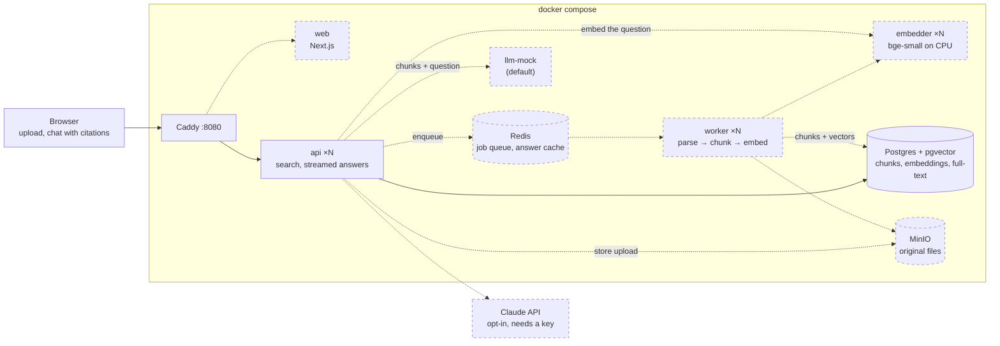

# Docs Q&A with citations

Ask questions about your docs and get streamed answers that cite the exact source passage, measured by an eval suite.

The step-by-step build plan is in [PLAN.md](PLAN.md).

> **Status:** skeleton. The stack runs, scales and passes CI. The product itself isn't built yet.

## Run it

```bash
git clone --recurse-submodules https://github.com/gonzalo-gigena/docs-qa.git
cd docs-qa
cp .env.example .env
docker compose up --watch
```

Open http://localhost:8080. Needs only Docker with Compose v2. Code changes reload
automatically (Compose Watch). On Windows, clone inside the WSL filesystem, not `/mnt/c`.

Cloned without `--recurse-submodules`? Run `git submodule update --init`.

## Everyday commands

| What | Command |
|---|---|
| Seed demo data | `docker compose run --rm seed` |
| SQL shell | `docker compose exec db psql -U app app` |
| Scale the api | `docker compose up -d --scale api=3` |
| Prove scaling works | `sh common/scripts/smoke.sh 3` |
| Run exactly what CI runs | `sh common/scripts/ci-stack.sh 3` |
| Load test at 1, 2, 4 replicas | `sh common/scripts/scale.sh` |
| Metrics (Prometheus) | `docker compose --profile observability up -d`, then http://localhost:9090 |
| Unit tests | `docker run --rm -v "$PWD/apps/api:/src" -w /src python:3.14.10-slim python -m compileall -q app` |
| New migration | add `infra/db/migrations/00000N_name.up.sql` + `.down.sql`, restart |
| Update shared code | `git submodule update --remote common` |
| Reset everything | `docker compose down -v` |

## Architecture



Solid boxes and arrows run today. Dashed ones are planned in [PLAN.md](PLAN.md).

Ingestion and answering are separate paths. Uploads go through a queue to workers, so heavy ingestion never slows chat down. Answers use only retrieved chunks, and each citation points to the exact passage.

## Stack

- **api:** Python 3.14 (FastAPI + psycopg + Prometheus client). Stateless, so it scales with `--scale api=N`.
- **Caddy:** the only service with a host port. It load-balances `/api/*` across every
  replica (`import lb api 8080`, from common) and serves `apps/web`.
- **Postgres 17 with pgvector:** migrations run once before the api starts (`golang-migrate`).
- **common/:** git submodule with the shared fakes, scripts, Caddy snippet and Prometheus.
  See [portfolio-common](common/README.md).

## Deploy (one VM)

```bash
docker compose -f compose.yaml -f compose.prod.yaml up -d
```

The server's `.env` needs `SITE_ADDRESS`, `IMAGE_REPO`, `TAG`, a strong password, and no `fakes`
profile. Caddy gets TLS automatically. CI pushes multi-arch images to GHCR on every merge to `main`.

## Decisions & tradeoffs

| Decision | Chosen | Rejected | Why, and what it costs |
|---|---|---|---|
| Vector store | pgvector in the same Postgres (HNSW, cosine) | Pinecone, Qdrant, Weaviate | Vectors, text, the full-text index and permissions live in one database and one transaction. That holds up to roughly 10M chunks. Cost: HNSW filters after the index scan, so a small workspace can get fewer than k results. pgvector 0.8 iterative scans fix that. |
| Retrieval | Hybrid: vector top-k plus Postgres full-text, merged with Reciprocal Rank Fusion | Vector search only | Keyword search catches exact names, error codes and identifiers that embeddings blur. The recall@5 eval has to confirm it. |
| Embeddings | Local `fastembed` (bge-small-en-v1.5, 384 dimensions, ONNX on CPU), model baked into the image | A hosted embedding API | Runs offline on any laptop, arm64 or amd64, with no key. Cost: weaker than large hosted models, and its 512-token limit sets chunk size (~400 tokens, ~15% overlap). |
| Citations | The Claude API's built-in citations on document blocks | Asking the model for `[1]` markers and parsing them | Each cited sentence maps to a chunk and a character range. Cost: citations can't be combined with structured outputs. |
| LLM provider | One small interface: the Claude API (`claude-opus-5-5`) or `llm-mock` | Calling the SDK throughout the code | Tests, CI and offline runs need no key. It's the only abstraction worth having here. |
| Untrusted documents | Document text is treated as data: the system prompt says so, and the model has no tools | Trusting document text | Documents can contain prompt-injection text. With no tools, the worst case is a bad answer, not an action. |
| Measuring quality | An eval suite: recall@k and MRR on every PR with a CI threshold, LLM-judged answer evals nightly | Judging answers by eye | Chunk size, hybrid vs vector and reranking become measured choices. Answer evals cost money, so they don't run on every PR. |
| Load balancing | Caddy `dynamic a` upstreams (the `lb` snippet in `common/`) | `reverse_proxy api:8080`, Traefik | Caddy re-reads Docker DNS every 5 s, so `--scale api=N` needs no config change and no Docker socket mount. A plain `reverse_proxy api:8080` is a single upstream to Caddy and doesn't reliably spread load. |
| Migrations | A one-shot `migrate` service that finishes before the api starts | Each replica migrating on boot | Replicas starting together would race on the same migration. |

Rows for parts that aren't built yet record the plan's choice. Each one gets confirmed or revised when that phase is built.

## Scaling

### Measured

The skeleton only, not the product yet: k6 with 20 virtual users for 20 s against `GET /api/hello`, which reads one row from Postgres through Caddy. Run on an Apple M1 laptop with 8 CPUs and 8 GB given to Docker, with the dev override left out:

```bash
COMPOSE_FILE=compose.yaml sh common/scripts/scale.sh
```

| api replicas | req/s | p95 latency | failed |
|---|---|---|---|
| 1 | 2,095 | 11.63 ms | 0.00% |
| 2 | 3,488 | 11.13 ms | 0.00% |
| 4 | 4,764 | 8.47 ms | 0.00% |

4 replicas served 2.3× the requests of 1. Each uvicorn process runs on one core, and at 1 replica it sat at ~100% CPU (sampled with `docker stats`), so the api was the bottleneck and replicas helped. p95 dropped as well. Running several uvicorn workers per container would get a similar gain with fewer containers.

### How each part scales

| Part | Scales by | Limit |
|---|---|---|
| `api` | `--scale api=N` (stateless) | Open answer streams, each waiting on the LLM. The LLM call never runs inside a database transaction. |
| `worker` | `--scale worker=N` | Ingestion pages/min |
| `embedder` | `--scale embedder=N`, separately from workers | CPU-bound, ~1–2 GB RAM per replica |
| Postgres + pgvector | One primary | HNSW index memory |
| Redis | One instance | Job queue and answer cache |

### Where it breaks next

- **Time to first token** is the LLM's, not the stack's. The Redis answer cache, keyed by `(workspace_id, normalized question, corpus_version)`, helps repeated questions.
- **Embedding throughput during bulk ingestion.** Scale `embedder` on its own, or opt into a hosted embedding provider.
- **Past roughly 10M chunks**, the HNSW index stops fitting in memory. That's the point to consider a dedicated vector database.

Phase 6 adds the real tests: ingestion pages/min at `--scale worker=4`, and time to first token with 50 concurrent askers.
